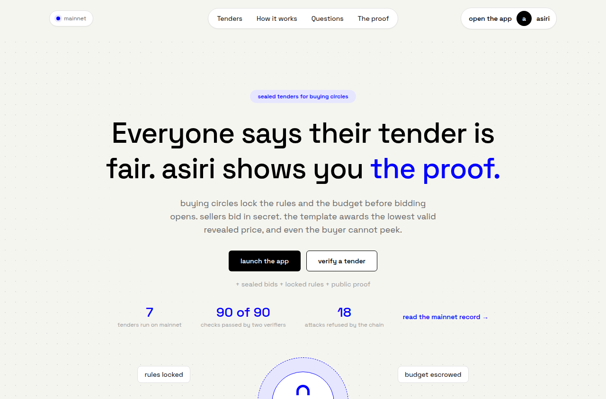

# Asiri

Sealed tenders for buying circles, on Tari Ootle. Live on mainnet.

**App:** https://asiri-libg.netlify.app · **Demo video:** https://youtu.be/f1ow5_5sJ1o



## The Problem

Buying circles, cooperatives, shop networks, and offices buy together to get better prices. The tender that picks the supplier is usually run on paper or in a chat group, and it can be rigged in quiet ways. The rules change after the bids are seen. A favoured supplier wins without the lowest price. Losing prices leak and get used against the losers in the next round. Nobody outside the room can check any of it afterwards.

Asiri runs the tender inside a Tari Ootle template instead, where those moves have no path.

## How It Works

1. **Lock the rules.** The circle writes the specification, the budget cap, and the windows into the template and escrows the budget. From that moment the rules cannot change.
2. **Bid in secret.** Each seller posts a sealed commitment and a bond. Nobody can open a bid early, not the circle, not rival sellers.
3. **Reveal to win.** When the bid window closes, sellers reveal their own bids. Only revealed bids can win. A bid nobody reveals stays sealed forever.
4. **The template awards.** The lowest valid revealed price wins under the locked rules. If the circle wants a different winner, payment stays blocked until the reason is written into the public record, with the price difference shown.
5. **Deliver, then settle.** The circle confirms delivery and the winner is paid from escrow, with a receipt anyone can verify.

The claim, stated exactly: the winner is the lowest valid revealed bid under the locked rules. Asiri never claims the winner beat bids nobody revealed.

## The Proof

- **7 tenders on mainnet**, against the Heartland Provisions Circle: a plain award, a tie, an override, a dispute, an expiry, a ten-seller tender, and one tender run purely to be attacked.
- **90 of 90 checks passed**, recomputed by two independent verifiers, the standalone script and the verifier inside the app, with identical readings on every tender.
- **18 attacks rejected by the chain**, each recorded in the chain's own words: duplicate bids, wrong salts, wrong prices, late bids, a rules rewrite after the lock, an override with no rationale, an override picking a bid nobody revealed, and double payment claims after settlement.
- **465 tests** across the engine, the app, and the standalone verifier.
- A **7-tender season on the Esmeralda testnet** ran first, with the same full verification.

Full records, tender by tender, with transactions, fees, and verifier counts: [`evidence/mainnet.md`](evidence/mainnet.md) and [`evidence/esmeralda.md`](evidence/esmeralda.md).

## Run It Yourself

Open the app, no install needed: https://asiri-libg.netlify.app. It defaults to mainnet, with an Esmeralda switch kept. Reading and verifying need no wallet at all.

Or check any tender from the command line. It needs Python 3 and nothing else, no wallet, no account, no keys:

```
pip install asiri-verify
asiri-verify component_84e25948c447c3ee437e783fc29b4bfebf18fb2cc1bee1c0ed41598113ad37f2 --network mainnet
```

That is the gate tender from the mainnet season. A live re-run today reads 12 of 13, with the reveal recomputation as could not be read: the mainnet indexer no longer serves the reveal transaction bodies it served when the shipped receipts were produced at 13 of 13. The receipts in the app carry the full run.

Run the app locally:

```
cd app
npm install
npm run dev
```

Run the checks:

```
cd app && npm test          # app suite
python3 packages/asiri-verify/tests/test_verify.py   # standalone verifier, 72 tests
```

<details>
<summary>Security invariants</summary>

The templates are built so these properties hold by construction. Each one has an engine test named after it in the test suite.

- I1. Rules never change after the tender is locked and funded.
- I2. Escrow outflows never exceed escrow inflows, and the award payment never exceeds the cap.
- I3. A commitment can be revealed only by its own seller, only in the reveal window, and only with the exact committed price and salt.
- I4. No price is ever recorded for an unrevealed commitment.
- I5. The award always equals the lowest valid revealed price, ties broken by earliest reveal.
- I6. Money leaves a tender only through its settlement, expiry, and dispute paths.
- I7. An override cannot execute without a recorded rationale hash and approver signatures at threshold.
- I8. Delivery payment cannot execute without delivery confirmations at threshold, except through dispute resolution at its higher threshold with a recorded rationale.
- I9. Every bond is accounted for at every terminal state: returned in full, or forfeited on the recorded split. Half of a forfeited bond goes to the circle, and half stays locked in the tender forever, where no method can release it. The locked amount is part of the tender's public record.
- I10. One commitment per seller per tender, enforced by the template state.
- I11. Windows are enforced by engine epochs. No caller's arguments can move a deadline.
- I12. Neither component has an owner. No key can upgrade the code, move funds, change rules, or alter an outcome.
- I13. A tender with no valid reveals always ends expired with full refunds. It can never default to an award.
- I14. The winner paid is always the payment identity bound in the winning commitment.
- I15. Every state transition emits an event, and the events plus the tender's public record suffice to reconstruct what happened without trusting the app.

</details>

<details>
<summary>Verify a tender yourself, in detail</summary>

`scripts/verify.py` reads one tender and its circle from the network's public indexer and checks the record end to end: the component runs the published template code, the rules hash recomputes from the displayed rules, the escrow funding matches the budget cap, every reveal verifies against its commitment, the award is the lowest valid revealed price under the locked rules, or a threshold-approved override whose chosen bid is itself a valid revealed bid and whose rationale hash matches the published text when you supply it, the settlement equals the award, was reached only after delivery confirmation at threshold or a dispute resolved for the winner at its higher threshold, and honours the winning commitment's payment identity, and every bond reached a recorded outcome, the forfeit split is recorded, and the bond vault reconciles.

Run it from the repo root with no install:

```
python3 scripts/verify.py component_<tender address>
python3 scripts/verify.py component_<tender address> --network esmeralda
```

Mainnet is the default network; pass `--network esmeralda` for a testnet tender. Add `--receipt` to print the full receipt as JSON instead of the check list, `--json` for the check list as JSON, and `--rationale <path>` to check an override's published rationale text against its recorded hash. For an override tender, run with `--rationale`: without the text, that one check reports a fail marked unverifiable, because the run was never given the text to check.

Each check prints one line, pass, fail, or could not be read, and the run ends with a count. The exit code is zero only when every check passes. Could not be read means a reveal's transaction could not be read from any indexer, so that reveal cannot be recomputed against its commitment today, for example when an indexer has pruned old transaction bodies. It is neither a pass nor a failure, and the tender is not fully verified until every check has run, so the exit code stays non-zero.

</details>

<details>
<summary>Attack your own tender</summary>

`scripts/attack.py` drives one tender of your own through the attacks a sealed tender has to survive, and reports what the chain does with each one. It takes a draft tender you created in the app and registered in your circle, locks and funds it, commits three bids from three of your accounts, and then, inside the tender's own windows, submits a duplicate commitment, a bid carrying too small a bond, a rules rewrite after the lock, a bid after the deadline, reveals with the wrong salt, the wrong price, and another account's identity, a reveal of a bid that was never committed, an early close of the reveal window, an early move to delivery, an override with an all-zero rationale hash, an override choosing a bid nobody revealed, and an override signed by a single approver, which the tool then checks on a live read to confirm the award did not move. After settlement it submits payment and bond claims by the wrong accounts, a second payment claim by the winner, and a direct call to the tender's internal refund path. The tender finishes honestly between the attacks: two bids reveal, the lowest valid revealed bid wins, delivery is confirmed at threshold, and the normal claims land. One bid is never revealed on purpose, so it ends the tender still sealed and its bond forfeits.

Every attack is expected to be rejected, and the tool prints each rejection in the chain's own words. An attack that is accepted, or an honest step that is rejected, stops the run at once and the exit code is non-zero.

It needs Python 3, a running tari_ootle_walletd holding the five accounts (an operator who is a circle approver, a second approver, and three sellers), and the daemon's cookie file. Run it from the repo root:

```
python3 scripts/attack.py --tender component_<tender address> --circle component_<circle address> --cookie <path to the daemon .cookie file>
```

Account names, prices, the daemon address, and the network are flags; run it with `--help` for the full list, and add `--report <path>` to save the run as JSON. Run it only against your own deployment: the transactions are real, a rejected attack still pays its network fee, the escrow comes out of the operator account, and the sealed bid's bond forfeits by design.

</details>

<details>
<summary>Status on mainnet</summary>

The templates are published on Tari mainnet: circle template `template_b86a46241753b8b8e4c2e9571c0db727925d77e1274009175e4f0b0e18cf466b`, tender template `template_267d1d73da73ec990e8711e492bccb9112076051d396922bdef2b9d667c684eb`. The bytes published were the exact esmeralda template bytes. The mainnet network recompiled the code at publish time, so the stored code hashes differ from esmeralda's while the template interface is identical.

The Heartland Provisions Circle is live on mainnet at `component_46237d52379c5d9289814c67ca840f5fa2aad2b12ed2291acf0e74a5091aca71`, three approvers, threshold 2. A season of six tenders ran against it: a plain award, a tie, an override, a dispute, an expiry, and a ten-seller tender. Each one settled or expired and was verified in full by both the standalone script and the app's verifier, with identical readings. A seventh mainnet tender was then run purely as an attack test: eighteen attack transactions were submitted inside its own windows and the chain rejected every one, a single approver's override signature left the award unchanged, one bid ended the tender still sealed, and the tender settled honestly and was verified in full by both verifiers. The same product ran a seven-tender season on the esmeralda testnet before mainnet.

The web app is live at https://asiri-libg.netlify.app and defaults to mainnet, with an esmeralda switch kept. Its results page carries the esmeralda season's recorded receipts and the mainnet season's records, each under its own network's view. Every tender on either network can be re-checked with the verifier above.

</details>
